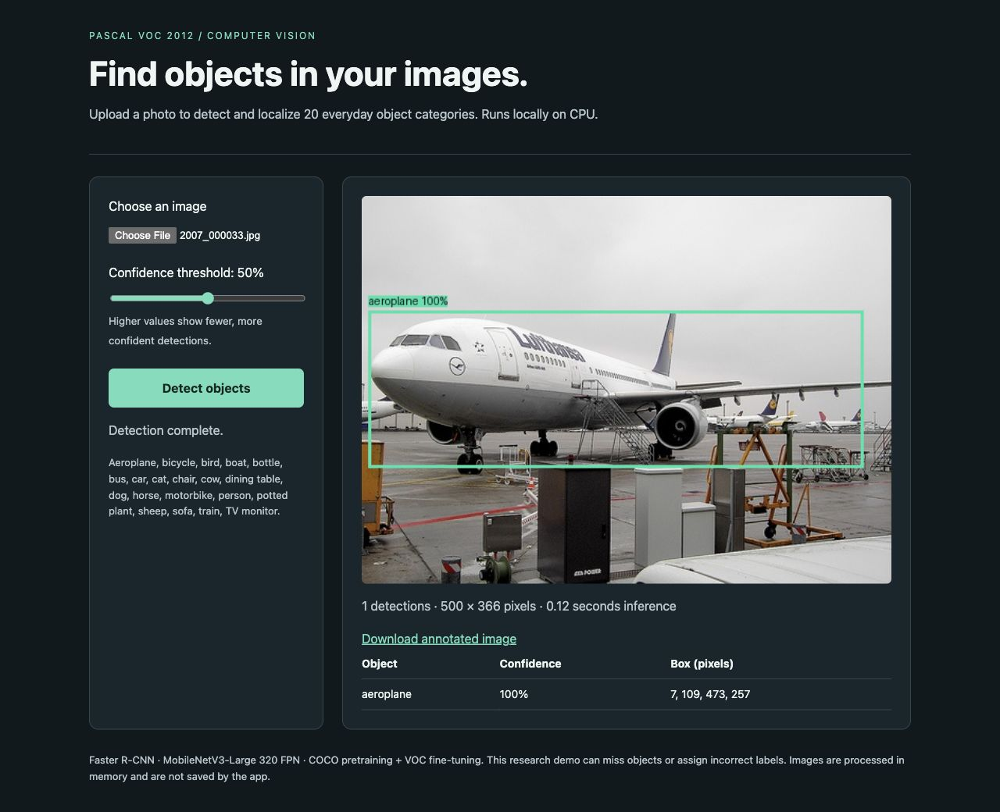
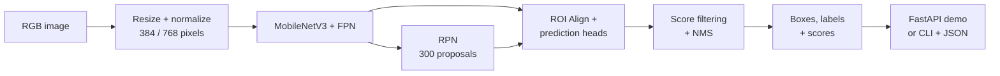
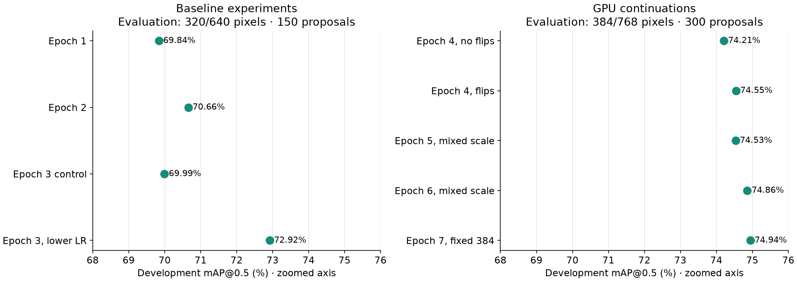
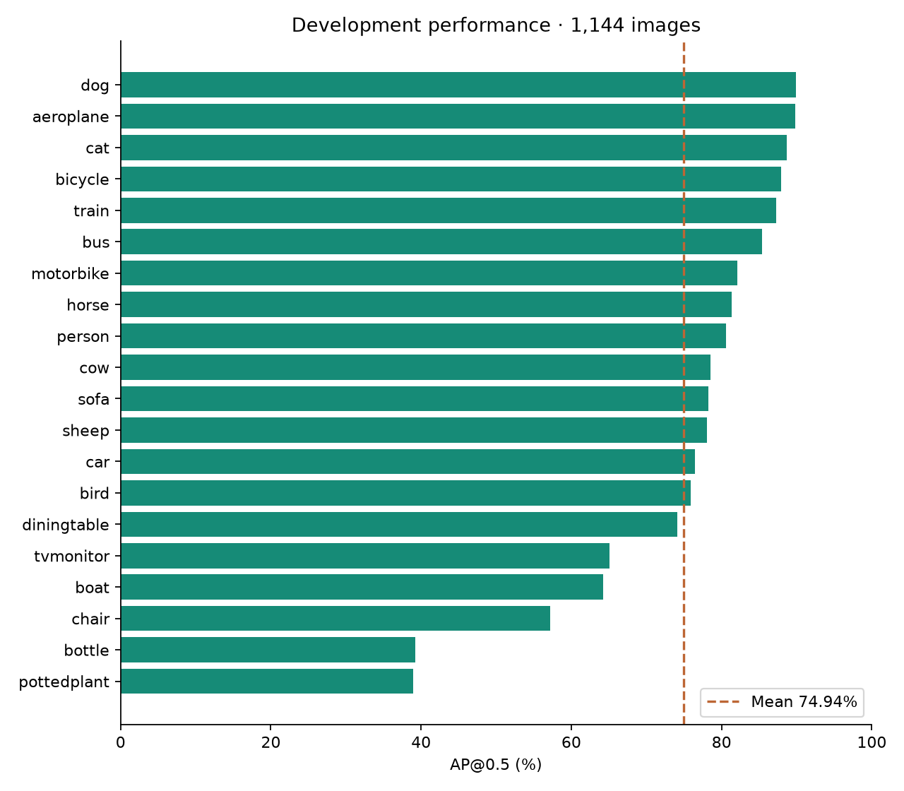
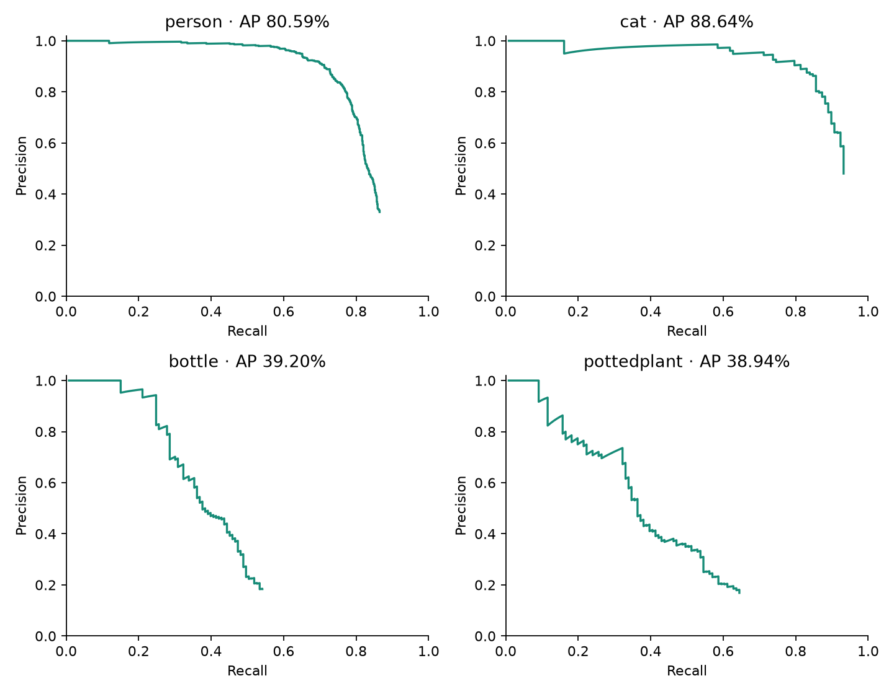
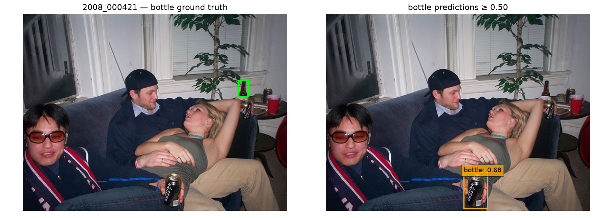

# Pascal VOC 2012 object detection

An end-to-end CPU object detector: COCO-pretrained Faster R-CNN MobileNetV3-Large
320 FPN, fine-tuned for the 20 Pascal VOC categories, served through **FastAPI**
with a browser demo, typed JSON responses, and a tested **Docker** deployment.

**Held-out validation mAP@0.5: 74.17%** on 5,823 images.
Development mAP@0.5: **74.94%** on 1,144 images. Both were freshly recomputed
from the selected exported weights. See [technical report](reports/technical_report.md),
[experiment table](reports/experiments.csv), and [submission checklist](SUBMISSION.md).
The selected inference configuration is 384/768 pixels with 300 region proposals.
Final held-out results are in `reports/evaluation/val/summary.json`. The earlier
epoch-3 results remain under `reports/evaluation/epoch3_dev` and `epoch3_val`.
A free Tesla T4 attempt was stopped without a completed scored checkpoint;
see [cloud attempt](reports/cloud_attempt.md). The selected model was trained locally on MPS.

## See it in action



The working local demo accepts a new image, draws labelled boxes, reports confidence
scores, and lets you download the annotated result. The screenshot shows a VOC
example at a 0.5 display threshold; it is an illustration, not an additional test score.

## How detection works



The two ROI inputs are shared image features and proposed regions. Predictions are
mapped back to original-image pixel coordinates before drawing. COCO pretraining
is followed by VOC fine-tuning; final inference runs on CPU.

## What improved



Both panels use all 1,144 development images, but their inference settings differ:
the baseline panel uses 320/640 pixels and 150 proposals; the GPU panel uses
384/768 pixels and 300 proposals. The total gain from 72.92% to 74.94% therefore
combines training and inference changes. Dots use a clearly zoomed percentage axis.
The rejected epoch-2 640/1280 trial scored 52.03% and is outside the plotted range;
see the [complete training table](reports/experiments.csv) and
[configuration comparisons](reports/technical_report.md#3-experiments-and-decisions).
Final validation on the separate 5,823-image split scored **74.17%**.

<details>
<summary>Explore performance across all 20 categories</summary>



The dashed line is the unweighted mean across categories. Bottles and potted plants
remain difficult despite the aggregate improvement. These are development scores;
[validation category scores](reports/evaluation/val/per_category.csv) are reported separately.



AP summarizes the precision-recall curve rather than accuracy at one display threshold.

</details>

## Where it still struggles



Left: green annotation boxes, dashed for difficult objects. Right: orange predictions
with confidence at least 0.5. Here, the table bottle is missed while the foreground
can receives a bottle prediction. This is one illustrative development image, not a
frequency estimate. In the full development split, the selected model misses
145 of 160 objects smaller than 32 × 32 original-image pixels at that threshold.
The [structured error counts](reports/evaluation/dev/error_counts_at_050.csv) and
[technical report](reports/technical_report.md#4-evaluation-and-errors) quantify the limitations.


## Run the demo

Download the [complete submission ZIP](https://github.com/faikbairamov/pascal-voc-object-detection/releases/latest/download/pascal-voc-submission.zip), which includes `models/best.pt`. Model binaries are deliberately
excluded from Git; when using only a GitHub checkout, obtain the supplied weights
from the accompanying submission ZIP, or follow the training instructions below.
Verify the file against `models/best.metadata.json` (SHA-256).

Use **Python 3.14**. The project was checked on macOS ARM64 and the serving image
on Linux ARM64. Other platforms have not been verified.

```bash
python3.14 -m venv .venv
.venv/bin/python -m pip install -r requirements.txt
.venv/bin/python -m voc_detection.demo
```

Open [the demo](http://127.0.0.1:7860) and upload a JPEG or PNG. The model returns
an annotated image and a table of detections. Change the confidence slider to
explore the precision/recall tradeoff. No weights download or dataset is needed
for inference. The app does not retain uploads; framework upload parsing may use
temporary files. It processes one model request at a time.

For a smaller serving-only environment, install `requirements-serving.txt` instead.
On Linux, install CPU-only PyTorch first as in the Dockerfile to avoid CUDA packages.

```bash
.venv/bin/python -m voc_detection.inference /path/to/photo.jpg --output outputs/prediction.png
```

This writes an annotated PNG and a JSON file. Model classes are fixed to VOC;
objects outside those categories may be missed or misclassified.

## FastAPI and Docker

Interactive API documentation: [Swagger UI](http://127.0.0.1:7860/docs).
Machine-readable contract: `/openapi.json`. Endpoints:

| Endpoint | Behavior |
| --- | --- |
| `GET /` | Browser upload demo |
| `GET /health` | Model readiness and device |
| `POST /predict` | Multipart `image` and optional `threshold` (0–1, default 0.5) |

`POST /predict` returns image dimensions, detections (`label`, `class_id`, `score`,
`box`), model inference time, and an annotated PNG data URL. Boxes are zero-based
`[xmin, ymin, xmax, ymax]` in original-image pixels, with exclusive end coordinates.
Invalid image bytes return 400, oversized files 413, and invalid/missing fields 422.
Limits: 10 MB image bytes and 20 million pixels. This is a local demonstration,
without authentication or a production serving/load-testing claim.

```bash
curl -F image=@/path/to/photo.jpg -F threshold=0.5 http://127.0.0.1:7860/predict

docker build -t voc-detector:submission .
docker run --rm -p 127.0.0.1:7860:7860 voc-detector:submission
```

The image uses CPU-only PyTorch, runs as an unprivileged user, includes a health
check, and contains the selected model. Build requires internet; inference does not.
Container verification evidence: `reports/verification/docker_smoke.json`.

## Data and evaluation protocol

Obtain Pascal VOC **2012 train/val**, not the separate test-image archive, from the
[VOC project](http://host.robots.ox.ac.uk/pascal/VOC/voc2012/). Extract it beside this repository:

```text
workspace/
  VOCdevkit/VOC2012/{JPEGImages,Annotations,ImageSets,...}
  pascal-voc-object-detection/
```

Alternatively set `dataset_dir` in `configs/baseline.json`; evaluation and training
also accept `--dataset /absolute/path/to/VOC2012`. The original fixed scikit-learn
seed-42 image split is committed: 4,573 fit and 1,144 development images, partitioning
the official train list. Official val contains 5,823 held-out images. Keep the split
files unchanged across experiments. All 11,540 images passed decode/annotation and
split-isolation checks; details are in `reports/data/summary.json`.

The custom evaluator reports VOC all-points interpolated AP with strict IoU > 0.5.
It ignores matches to difficult annotations and counts duplicates as false positives.
It uses all predictions returned by the detector (default internal score threshold,
NMS and detection cap), without the demo's 0.5 display filter. This is neither
COCO mAP@[.5:.95] nor an official VOC test-server submission. Exact numerical parity
with the official devkit has not been independently established.

```bash
.venv/bin/python -m voc_detection.audit
.venv/bin/python -m voc_detection.evaluate --split dev --output reports/evaluation/dev
.venv/bin/python -m voc_detection.evaluate --split val --output reports/evaluation/val
```

The val result evaluates a frozen model selected on development. Do not tune against
val. Evaluation saves per-class CSVs, provenance JSON, and ignored `.pt` prediction
records. The dataset and local records are not necessary for the inference demo.

## Train or reproduce the approach

Training requires the dataset and downloads the TorchVision COCO weights on first
use. The observed historical CPU epochs took about 16 minutes each. Hardware and
library versions affect timings and exact reproducibility.

```bash
# Baseline: two epochs, SGD learning rate 0.001.
.venv/bin/python -m voc_detection.train --epochs 2

# Use the printed epoch-2 TRAINING checkpoint path in the next command.
.venv/bin/python -m voc_detection.train --resume /path/to/epoch_2.pt --epochs 1 --lr 0.0001 --restart-shuffle

# Additional selected-model recipe, using the printed checkpoint from each step.
# MPS means Apple's GPU; use --device cpu on a machine without MPS.
PYTORCH_ENABLE_MPS_FALLBACK=1 .venv/bin/python -m voc_detection.train --resume /path/to/epoch_3.pt --epochs 1 --lr 0.0001 --device mps --horizontal-flip 0.5 --name mps-epoch4-horizontal-flip
PYTORCH_ENABLE_MPS_FALLBACK=1 .venv/bin/python -m voc_detection.train --resume /path/to/epoch_4.pt --epochs 2 --device mps --horizontal-flip 0.5 --train-min-sizes 320 384 --train-max-size 768 --name mps-multiscale-continuation
PYTORCH_ENABLE_MPS_FALLBACK=1 .venv/bin/python -m voc_detection.train --resume /path/to/epoch_6.pt --epochs 1 --device mps --horizontal-flip 0.5 --train-min-sizes 384 --train-max-size 768 --name mps-epoch7-fixed384

# Export the selected epoch-7 weights and the settings chosen on development.
.venv/bin/python -m voc_detection.export /path/to/epoch_7.pt --min-size 384 --max-size 768 --proposals 300
```

The original epoch-3 best result came from a continuation of epoch 2 with reset seed-42
shuffle and learning rate 0.0001. `--restart-shuffle` reproduces that policy. Normal
resume restores saved Torch/loader RNG state when available; original epoch-1/2
checkpoints do not contain that state. Resume requires a full training checkpoint,
not `models/best.pt`. Training preserves TorchVision's pretrained frozen-normalization
and trainable-backbone policy; offline serving reconstructs weights for evaluation.
The historical baseline used resizing/normalization only. New selected-model
continuations use 0.5 horizontal flips, mixed training scales for epochs 5/6,
and fixed 384-pixel training for epoch 7. CPU development evaluation at 320 is
logged by the training CLI; separate dev sweeps select deployment at 384/768
with 300 proposals. Those are distinct evaluation settings and scores.

New runs save model/optimizer/RNG state under `mlflow_local/checkpoints/` and log
metrics, splits, and checkpoints to local MLflow. The supplied weights let a reviewer
run the actual selected model without attempting to reproduce its exact score.

```bash
.venv/bin/mlflow ui --backend-store-uri sqlite:///mlflow_local/tracking.db --host 127.0.0.1 --port 5000
```

Existing MLflow artifact paths point to their original location; do not move the local
tracking directory. Portable experiment evidence is exported to `reports/`.

## Optimization and verification

```bash
.venv/bin/python -m voc_detection.evaluate --split dev --proposals 75 --output reports/optimization/proposals75
.venv/bin/python -m voc_detection.benchmark
# Optional, isolated legacy dynamic-quantization experiment:
.venv/bin/python -m voc_detection.quantization
.venv/bin/python -m unittest discover -s tests -v
.venv/bin/python -m voc_detection.smoke /path/to/photo.jpg --url http://127.0.0.1:7860 --output reports/verification/local_smoke.json
```

Run latency benchmarks without competing training/evaluation jobs. They warm up each
setting, alternate execution order, use fixed development images, and report mean,
median, and p95 forward latency. See the technical report for measured tradeoffs.
`torch.ao` dynamic quantization is deprecated in the pinned PyTorch version; it is an
isolated experiment, not a requirement of the supported FP32 inference path.

## Structure

| Path | Purpose |
| --- | --- |
| `voc_detection/` | Dataset, model, training, metrics, API, inference, and report tooling |
| `configs/baseline.json`, `splits/` | Shared baseline and fixed image assignments |
| `notebooks/01*`, `02*` | Exploration and tiny-batch sanity checks |
| `notebooks/03*`, `04*` | Recorded training, resolution and learning-rate experiments |
| `notebooks/archive/` | Original workbook and preserved outputs |
| `models/best.metadata.json` | Selected model class order, provenance, size and hash |
| `reports/` | Results, figures, data audit, technical report and verification |
| `tests/` | Synthetic metric cases and API contract checks |
| `Dockerfile` | CPU FastAPI serving image |

Training cells in notebooks 03/04 require explicit opt-in flags and default to off;
saved outputs preserve historical experiments. Notebook 04 loads the historical
epoch-2 model for its comparisons. Use the CLI and `models/best.pt` for the final model.
Do not Run All in the archived workbook. Restart kernels after changing Python modules.

AI contributions and how they were checked are documented in [AI use](reports/ai_use.md).
